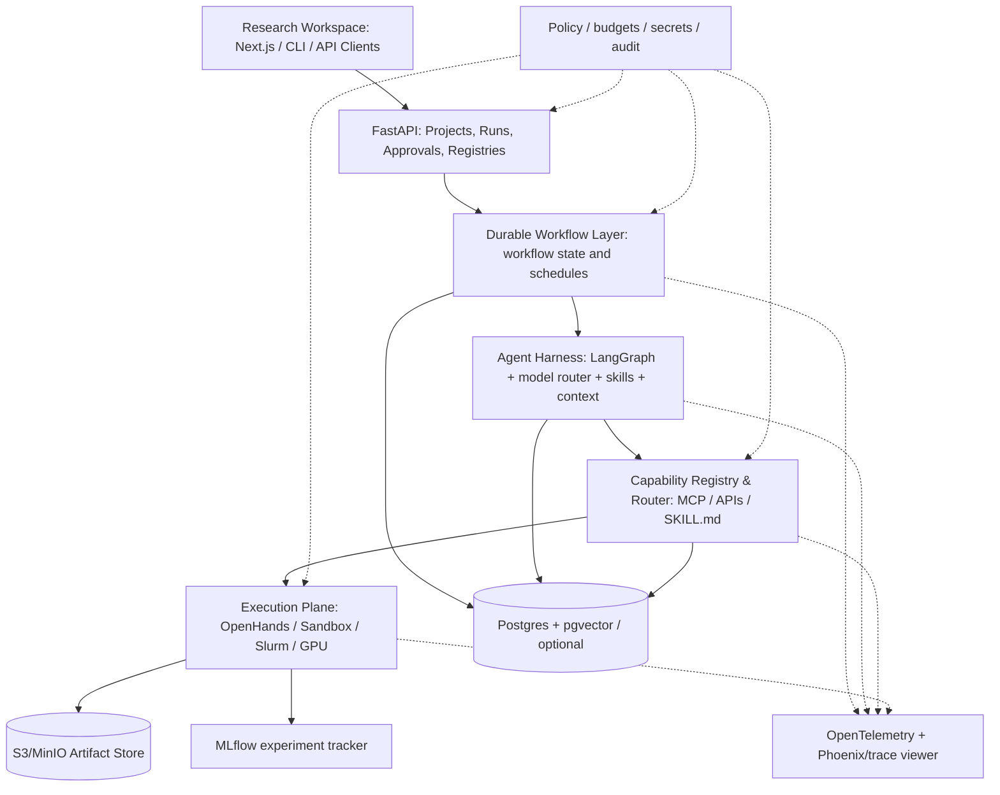

# AI4S Research OS — Detailed Architecture Design

## 0. Context and product scope

- Primary users: an individual or small CS/AI research team running multiple long-term research programs.
- Domain: ML algorithms, LLM/Agent research, evaluation, kernel optimization, inference systems, HPC scheduling, RL, research engineering.
- Out of scope for MVP: an autonomous public publisher, LLM-generated peer-reviewed conclusions without validation, biomedical lab robots, a universal autonomous scientific discovery claim, unlimited/unauthorized cluster access.
- Key value: transform scattered resources + benchmark rankings into *actual tested and authorized reusable capabilities*.

## 1. Layers and boundaries



**Layer 1: Workspace.** Web views: Portfolio, Research Radar, Papers/Evidence, Hypotheses, Plans, Experiment Runs, Benchmarks, Registry, Costs, Approvals, Progress and Artifacts. Support CLI for users who do not want browser interaction. Never claim a completed run merely because a card exists.

**Layer 2: Control plane.** Owns project lifecycle, permissions, workflow state machine, resource budgets, schedules, approvals, run idempotency and notifications. No LLM-generated action may bypass it.

**Layer 3: Agent intelligence.** Model policy, LangGraph state, task-scoped memory, evidence/idea/design/evaluation skills, provenance of model outputs. Agent roles may be composed, not all always active.

**Layer 4: Capability registry.** Universal ToolAdapter + Skill Manifest + MCP client. Inventory may include 100+ candidates; only audited/available subset active. Distinguish `discovered`, `reviewed`, `tested`, `enabled`, `disabled`, `broken`, `restricted`.

**Layer 5: Execution plane.** No arbitrary host shell. Code jobs execute isolated with resource ceilings and egress rules. Remote GPU jobs use approved Slurm/SSH or scheduler adapter. Training/inference runners call MLflow; output snapshots stored immutably.

**Layer 6: Data/knowledge.** PostgreSQL for relational workflow data, provenance and optional pgvector; object storage for content-addressed artifacts; Zotero optional sync; DVC optional for large versioned datasets; no competing sources of truth.

**Cross-cutting**: academic integrity, vendor/model authorization, security, policy, cost/quotas, traces, reproducible evaluation.

## 2. Architectural decisions (ADRs)

| ID | Decision | Justification | Avoid |
|---|---|---|---|
| ADR-001 | API/backend in Python/FastAPI, typed Pydantic domain models | ML/AI/HPC integrations predominantly Python | Business logic locked in HTTP handlers |
| ADR-002 | Postgres is canonical system of record | durable research objects and event log | Markdown files only for state |
| ADR-003 | Durable *research* workflow and *agent* workflows are separate | failures/approval/long waits distinct from reasoning loops | two frameworks acting as authoritative scheduler |
| ADR-004 | Phase 0-1: Postgres-backed job state + worker, LangGraph checkpoints; evaluate Temporal in Phase 2 | modest solo dev burden first, migration via typed interfaces | installing Celery, Prefect, Dagster, Temporal simultaneously |
| ADR-005 | Temporal is target durable orchestrator, not a dependency for offline Phase 0 | long-running schedules, retries, pause/resume | heavy computation in FastAPI background tasks |
| ADR-006 | OpenHands is one execution adapter (not workflow owner) | use mature Code Agent SDK | direct LLM-to-host-shell access |
| ADR-007 | Skill is a versioned instruction + optional references/scripts; Tool is executable capability | clean audit and permissions | conflating prompt with privileged tool invocation |
| ADR-008 | External tools behind port/adapter interfaces | vendor independence & tests | deep vendor SDK leakage across core |
| ADR-009 | MLflow experiment data + object artifacts; evaluation framework Inspect | research reproducibility | self-reported model quality as a fact |
| ADR-010 | Broad registry, narrow active tool set | integration first with safety and quality | activating every GitHub list entry |

**Notes**: LangGraph persistence: https://docs.langchain.com/oss/python/langgraph/persistence; Temporal: https://docs.temporal.io/develop/python; OpenHands: https://github.com/OpenHands/software-agent-sdk.

## 3. Major modules and interface contracts

### 3.1 Canonical registries

- `ResourceRegistry`: discovery metadata from GitHub Topics, Awesome Lists, Hugging Face Collections, benchmark catalogs; snapshot provenance, source timestamp and dedup reason.
- `ToolRegistry`: execution semantics, permissions, rate limits, cost, auth, provenance, input/output schemas, sandbox and adapter status.
- `SkillRegistry`: Agent Skills compliant bundle hash, metadata, declared tool permissions, applicability and regression tests.
- `ModelRegistry`: provider, immutable model identifier, context capacity (verify), cost policy, tool compatibility, data retention policy, active permissions.
- `BenchmarkRegistry`: exact task/dataset version, metric direction, evaluator code hash, permitted tools, resources, evaluation environment, public/holdout status.
- `PolicyRegistry`: institution/venue/year/track requirements with original link, review date and conflicts.

### 3.2 Port interface sketch (guide, not a completed implementation)

```python
from typing import Protocol, Any, Mapping
from dataclasses import dataclass

@dataclass(frozen=True)
class ToolContext:
    project_id: str
    task_id: str
    principal_id: str
    budget_id: str
    trace_id: str
    approval_token: str | None = None

class ToolAdapter(Protocol):
    name: str
    version: str
    async def healthcheck(self) -> Mapping[str, Any]: ...
    async def invoke(self, input: Mapping[str, Any], context: ToolContext) -> Mapping[str, Any]: ...

class ModelGateway(Protocol):
    async def generate(self, messages: list[dict], policy: Mapping[str, Any]) -> dict: ...

class ExperimentExecutor(Protocol):
    async def submit(self, contract_id: str, idempotency_key: str) -> str: ...
    async def status(self, external_job_id: str) -> Mapping[str, Any]: ...
    async def cancel(self, external_job_id: str) -> None: ...

class CitationResolver(Protocol):
    async def verify(self, source_id: str, claim_span: str) -> dict: ...
```

Tool router must check `enabled + schema_valid + policy_allowed + credentials_available + budget_remaining + trusted_version + approval_if_required` **before** invoking adapter. Every call returns typed success or explicit typed failure with trace and provenance. MCP remains transport, not a substitute for authorization.

### 3.3 Agent roles (few active agents; many composable skills)

1. **Research Coordinator** — decomposes tasks, chooses Skill and model policy, enforces research state; never grants its own privileged permissions.
2. **Evidence Analyst** — searches, parses and verifies source material and contradictory evidence.
3. **Research Designer** — suggests hypotheses, baselines, evaluations, next experiments; flags untested novelty claims.
4. **Experiment Engineer** — uses Coding Agent inside sandbox to implement immutable approved contracts.
5. **Independent Validator** — reads raw artifacts, checks experiment leakage, statistics, reproducibility, reports uncertainty; distinct tool policy from builder.

Agent logic should be invoked as sub-task (skill/workflow) rather than endless conversation. Defer fancy debate, agent society and self-play until causal benefit is demonstrated with measured evaluation.

### 3.4 Data sources and literature import

- Discovery adapters: Semantic Scholar, OpenAlex, arXiv, Crossref, OpenReview, Hugging Face Papers, GitHub sources. Apply API rate limits, attribution and content terms.
- Normalization: DOI normalized lower-case, arXiv ID preserving version, venue/year, repository URL, canonical URL, document hash; maintain alternate IDs and historical versions.
- Provenance: `source_url, retrieved_at, content_sha256, source_version, access_rights, section/page/span, extraction_method, model_version`.
- Claims have statuses `extracted, verified, disputed, unsupported, retracted`; do not auto-promote model-generated paraphrases to verified facts.
- `EvidenceEdge` relates claim to source, spans, figure/table evidence and supports/refutes; non-existent full-text span should remain unverified rather than fabricated.
- Resource lists can suggest candidates, but are not source of facts about current capabilities without source check.

### 3.5 Research memory

Split memory into:

- **Task memory**: immutable log of decisions and tool calls per run, checkpointed short-term graph state.
- **Project memory**: questions, hypotheses, confirmed facts, failed approaches, constraints, experiment results, paper and repo inventories.
- **Global discovery memory**: resources and benchmarks, each with source version and maintenance state.
- **Procedural memory**: versioned Skills, test cases and proven workflows.

Keep conclusions + supporting evidence + contradictions, not only a compact summary. No destructive context compaction when scientific constraints or critical tool feedback are at risk. Rehydrate by IDs rather than copying all documents into prompts.

## 4. State machine & lifecycle

Research project flow:

```text
DRAFT -> DISCOVERING -> EVIDENCE_READY -> IDEATING -> DESIGN_REVIEW
DESIGN_REVIEW -- approved --> EXPERIMENT_READY -> RUNNING -> ANALYZING
ANALYZING -> INDEPENDENT_VALIDATION -> REPORT_REVIEW
REPORT_REVIEW -> ITERATING | ARCHIVED | READY_FOR_HUMAN_PUBLICATION
Any running state -> PAUSED | FAILED | CANCEL_REQUESTED
PAUSED -> prior resumable state
```

Store `run_id`, `workflow_version`, `current_state`, `last_checkpoint`, `version_counter` (optimistic locking), event stream, actor and reason. Event schema includes timestamp, trace ID, input/output artifact references and idempotency key. Use transactional outbox to prevent DB state updates and job dispatch from disagreeing.

On crash, reload from durable checkpoint and reconcile executor external_job_id. Retry transient reads with exponential backoff; never blindly retry destructive writes or GPU job submission. Use idempotency key `contract_sha + attempt_group + executor + dataset_version` to prevent duplicate job submissions; distinguish retrying a call from a deliberate new replicate.

## 5. Workflow templates (target, not all in MVP)

**W1 Paper Radar**: scheduled queries → dedup → semantic/graph topic relevance → primary-source checks → concise dated digest → prioritized backlog; new paper does not force new experiment.

**W2 Research Gap**: freeze question → retrieve related work → build claim/evidence graph → novelty matrix (problem, baseline, data, method, limitations) → propose 3-5 options → critic compares and explains both promise and limitations → user selects.

**W3 AutoExperiment**: approved contract → fork isolated git worktree → build or modify code → unit tests → baseline → candidate → replicate with multiple seeds → metric/statistical report → discard/keep with data → enqueue next hypotheses within budget.

**W4 AI Systems**: profile workload and host/remote device → record source/driver/framework/runtime → performance baselines → correctness/regression tests → candidate optimization (CUDA/Triton/LLM scheduling) → compare TTFT/P50/P95/throughput/accuracy/CPU/GPU utilization as applicable → safety and reproducibility audit.

**W5 Artifact & Paper**: evidence-backed outline, tables from raw metrics, citation verification, reproducibility checklist, ethics/venue policy lookup, draft support with human final authorship/review. Never auto-submit.

## 6. Data model (minimum entities)

| Table | Critical fields |
|---|---|
| `projects` | id, title, domain, description, owner, policy_id, visibility, created_at |
| `research_questions` | id, project_id, question, scope, constraints, status |
| `resources` | id, canonical_url, type, license, maintainer, last_checked, status |
| `resource_observations` | resource_id, discovery_source, seen_at, source_snapshot, observation_hash |
| `papers` | id, doi, arxiv_id, title, year, venue, source_version, rights |
| `paper_snapshots` | id, paper_id, checksum, retrieval_time, artifact_ref, parser_version |
| `claims` | id, project_id, content, claim_type, verification_state |
| `evidence_edges` | claim_id, paper_snapshot_id, location/span, polarity, verifier, status |
| `hypotheses` | id, project_id, statement, rationale, status, counterarguments |
| `experiment_contracts` | id, hypothesis_id, sha256, frozen_at, benchmarks, baselines, seeds, metrics, cost_cap, approver |
| `experiment_runs` | id, contract_id, code_sha, env_digest, dataset_digest, tool_versions, executor, external_job_id, run_state |
| `run_metrics` | id, run_id, metric_name, value, units, n, seed, step, timestamp |
| `artifacts` | id, owner_type, owner_id, object_uri, hash, mime, visibility |
| `workflow_runs` | id, project_id, version, state, checkpoint_ref, budget_id, owner, last_heartbeat |
| `workflow_events` | id, run_id, seq_no, type, payload, trace_id, actor, timestamp |
| `approvals` | id, run_id, action, requested_scope, decision, reviewed_by, expires_at |
| `tools` / `skills` / `models` | id, version, status, manifest, verified_at, dependency_hash |
| `benchmarks` / `eval_runs` | task_version, scorer_hash, env_hash, model/agent, outputs, comparability_group |
| `budgets` / `usage_events` | quota, amount_used, provider, resource_kind, currency, alert_threshold |

Indices: canonical DOI/arxiv uniqueness with null handling; (run_id, seq_no) unique; external job ID unique per executor; source checksum indexes; project_id + created_at; artifact hash; audit log append-only. Store only references to big assets and prompt-heavy traces in DB.

## 7. API contract (v0; versioned /api/v1)

```text
GET    /healthz
GET    /projects
POST   /projects
GET    /projects/{id}
POST   /projects/{id}/research-questions
POST   /projects/{id}/research-runs
GET    /research-runs/{id}
POST   /research-runs/{id}/pause
POST   /research-runs/{id}/resume
POST   /research-runs/{id}/cancel
GET    /research-runs/{id}/events
GET    /research-runs/{id}/evidence
POST   /research-runs/{id}/approvals/{approval_id}/decide
GET    /projects/{id}/hypotheses
POST   /experiment-contracts
POST   /experiment-contracts/{id}/freeze
POST   /experiment-contracts/{id}/execute
GET    /experiment-runs/{id}/metrics
GET    /experiment-runs/{id}/artifacts
GET    /registries/resources?domain=ai-systems&status=tested
GET    /registries/tools
GET    /registries/skills
GET    /benchmarks
GET    /budgets/{project_id}
```

All mutating endpoints validate ownership, idempotency keys and authorization. Approval cannot be forged by the agent because the server verifies the authenticated user principal. Events can be server-sent events initially; WebSockets optional. Respond with URLs/IDs to actual stored outputs, never fabricated status.

## 8. Model & tool selection

- Task-based policies: cheap metadata extraction; stronger model for complex research reasoning and critique; code agent for sandbox execution; deterministic tools for factual checks; external provider only if data governance permits.
- Configurable model routing with three paths: primary, fallback, local. Record actual model version, parameters, cost and reasons for fallback. Do not assume model names advertised on social media are usable APIs.
- Capability selection uses verified function, allowed permissions, version compatibility, budget, latency, success on comparable tasks and reproducibility; user preference may override within policy.
- Never compare different benchmark releases or undisclosed tool settings as identical results. Keep A/B performance tests within matched environments.

## 9. Deployment topology

**Local dev**: Docker Compose for Postgres, optional MinIO, MLflow server, API, worker; Next.js dev server; offline mock-fixture *data* only; actual CPU experiment in a restricted container. Redis optional if chosen worker needs it. No managed service required for smoke test.

**Personal live**: Same services with authenticated UI, encrypted secrets and backups; external APIs by credentials; bounded daily research radar.

**HPC integration**: Thin executor installed/approved on gateway or submit host; agents never SSH directly using unrestricted private keys. Parameterized Slurm templates; per-user resource quotas; no running code on login nodes; proper cleanup and no superuser. Use Apptainer when cluster policy forbids Docker.

**Later scale**: Temporal for durable execution + OpenTelemetry + separate worker pools (literature CPU, code sandbox, GPU schedulers). One authoritative scheduler per layer.

## 10. Threat model & mandatory guardrails

- Research content, README and MCP tool output may contain prompt injection; parsing always retains `untrusted` origin and cannot grant permission.
- An imported `SKILL.md` is executable *instructional content*; inspect its scripts, network calls, package installs and tool grants; run only when approved.
- Permissions: read-only sources by default; write to isolated project workspace; external publication/email/repo push/SSH/GPU > quota needs approval.
- Sandbox: non-root, no host Docker socket, read-only codebase when possible, outbound network allowlist, CPU/RAM/GPU quotas, process/time limits, isolated credentials, ephemeral filesystem and audit trail.
- Secrets: use scoped secrets and store references, not raw values in prompts/traces/exports; redact traces and papers with private data.
- Licenses: store source commit, SPDX when verifiable, data restrictions and derivative obligations. Unknown or incompatible means do not enable code vendoring.
- Budget kill switch: call/token caps + walltime + GPU hours + API cost. Pause, alert and stop on overrun or review threshold.
- Academic checks: no fake citations or metrics, provenance for figures, venue-specific disclosures and human approval for paper submission.

MCP security guidance: https://modelcontextprotocol.io/docs/2025-11-25/tutorials/security/security_best_practices

## 11. Reliability and observability

- Minimum OpenTelemetry spans: `project.run`, `workflow.step`, `model.generate`, `tool.invoke`, `executor.submit`, `job.poll`, `artifact.store`, `eval.score`.
- Record input/output hashes, model token usage, tool failure reason, queue wait, execution duration, workflow retry and approval state.
- SLOs should be set only after measuring baselines, e.g. successful resume after intentionally killed worker, not fabricated performance numbers.
- A state cannot transition to `COMPLETE` unless required artifacts and checks exist; all partial runs visible with errors.
- Trace UI separate from experiment data; MLflow remains source of truth for experiment metric history.

## 12. Critical risks and technical debt rules

1. Too many frameworks: prohibit simultaneous orchestration stack creep.
2. Benchmark contamination: train/dev/holdout separation; no leakage of hidden labels.
3. Closed services masquerading as open source: mark `API-only` and cost.
4. Overly defensive research selection: record promising but uncertain ideas; permit *bounded* exploratory experiments; don't demand theoretical novelty before low-cost tests.
5. False novelty and optimization: require true baselines and independent validity checks; negative results never silently discarded.
6. User fatigue: concise progress summaries backed by deep logs; meaningful review gates, not approval every safe read operation.

## 13. Design verification checklist

- Can a paper list be ingested with provenance and no duplicate canonical URLs?
- Can a research workflow stop, resume and reconcile external run IDs without duplicate experiments?
- Can a user inspect exactly why an idea was selected or rejected?
- Can the same experiment run on local CPU and remote scheduler through an interface?
- Can an unsafe third-party Skill be indexed but remain disabled?
- Can a model provider be changed via config without changing experiment code?
- Can a report reconstruct every claimed metric and citation from durable IDs?
- Can an offline test pass without tokens, network, secret or GPU?
